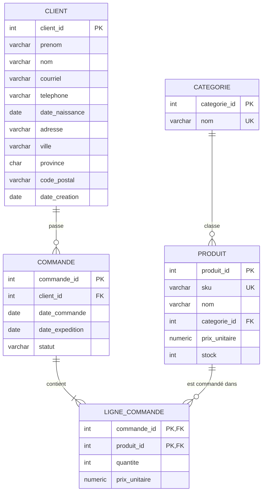

# Modèle de données

## Diagramme entité-relation

## Normalisation (3NF)

Dépendances fonctionnelles de chaque table :

| Table | Clé | Dépendances fonctionnelles |
|---|---|---|
| `categorie` | `categorie_id` | `categorie_id → nom` |
| `client` | `client_id` | `client_id →` tous les autres attributs |
| `produit` | `produit_id` | `produit_id →` tous les autres attributs, et `sku → produit_id` (clé candidate) |
| `commande` | `commande_id` | `commande_id → client_id, date_commande, date_expedition, statut` |
| `ligne_commande` | `(commande_id, produit_id)` | `(commande_id, produit_id) → quantite, prix_unitaire` |

Toutes les tables sont en 3NF : aucun attribut ne dépend d'une partie seulement d'une clé composée, et aucun attribut non-clé ne dépend d'un autre attribut non-clé. Le nom de la catégorie est dans `categorie` au lieu d'être répété dans chaque produit, et les infos du client ou du produit ne sont pas répétées dans les commandes.

## Choix de conception

- `ligne_commande.prix_unitaire` n'est pas une redondance. C'est le prix facturé au moment de la vente, il ne change pas si le prix du catalogue change. La règle DQ-14 le compare au catalogue.
- L'adresse est dans `client` telle que saisie. Je n'ai pas séparé `code_postal → ville`, car un code postal peut couvrir plusieurs municipalités.
- Il n'y a pas de `UNIQUE` sur `client.courriel`. La base applique les contraintes de structure (clés, `CHECK`, clés étrangères). Les règles de qualité (format, doublons, cohérence entre les champs) sont vérifiées par des requêtes. Après le nettoyage des doublons, on pourrait ajouter un index unique sur le courriel en minuscules.
- Les tables sont créées dans un schéma `gestion` (PostgreSQL) ou une base `gestion` (MySQL).
